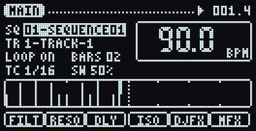
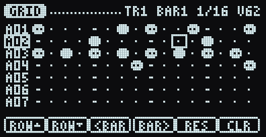
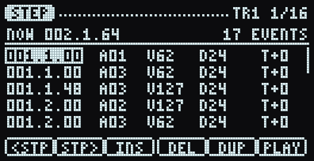
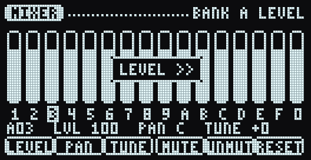
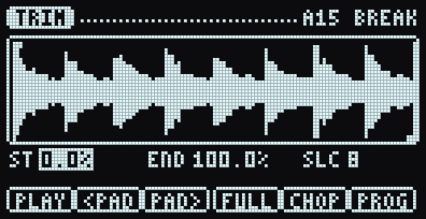
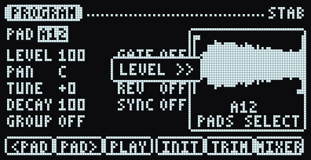
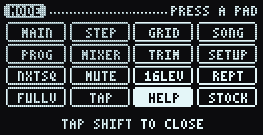
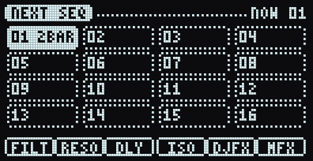
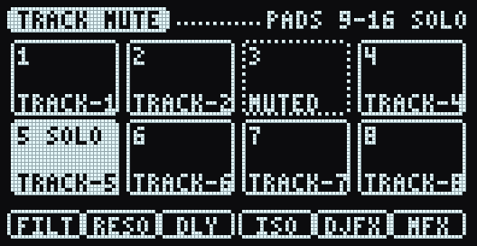
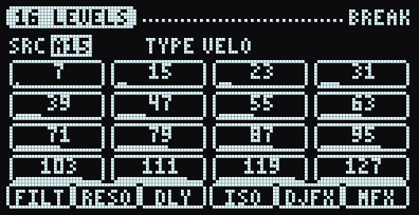

# Mosura OS

**An MPC-style operating system for the Roland SP-404MKII.**

Mosura OS brings the MPC2000XL / MPC2500 / MPC5000 way of working to the
SP-404MKII:

- one MAIN screen
- modes one gesture away
- cursor and data wheel
- labelled soft keys
- Q-Links
- a real sequencer you can see and edit

The goal is to end the menu diving and key combinations.



| | | |
|---|---|---|
|  |  |  |
|  |  |  |
|  |  |  |

## Status

| Part | State |
|---|---|
| Design and control model | done, see [docs/DESIGN.md](docs/DESIGN.md) |
| Core (UI + sequencer, portable C) | working, tested headless |
| Browser simulator | working: `sim/` |
| Cortex-M7 build | compiles (~33 KB code) |
| Firmware hooks | **not yet**: 0 of 10 verified, see [docs/ROADMAP.md](docs/ROADMAP.md) |
| Runs on a real SP-404MKII | **not yet** |

There is nothing to flash yet. `mospatch build` refuses to make an image
until every hook has been verified in an emulator.

## Try it

```sh
make sim                 # core -> sim/mosura.wasm (needs clang with the wasm32 target)
python3 -m http.server   # then open http://localhost:8000/sim/
make bundle              # or: one self-contained file, build/mosura-sim.html
```

Tap **SHIFT** for the mode grid. **Space** plays and stops. **Y** arms recording.
Pads are on `1234 / QWER / ASDF / ZXCV`. Drop a WAV onto a pad to load it.

## How it's built

```
core/        the OS: screens, control model, sequencer (freestanding C99, no libc)
sim/         browser host: WebAssembly core + panel + WebAudio stand-in sounds
port/sp404/  device host: glue the patched firmware calls; hooks.json
tools/       mospatch (firmware toolchain), tests, screenshots, font generator
docs/        design, hardware notes, roadmap, screenshots
```

One core, two hosts. The same `core/` C compiles to WebAssembly for the
simulator and to Thumb-2 for the unit's i.MX RT1060. The core draws in the
SSD1309's native page format and uses the firmware's own key IDs, so the
device port stays thin. Inputs the core doesn't use go to Roland's firmware
unchanged: sampling, effects and the looper keep working.

```sh
make test     # core behaviour tests + firmware-tool self tests
make device   # Cortex-M7 object + size report
make shots    # regenerate docs/img
```

## Legal

Mosura OS contains no Roland code and never distributes firmware. You
download the official System Program from Roland and the tools work on your
copy, on your computer. Modifying firmware is at your own risk. Mosura OS is
not affiliated with Roland or inMusic (Akai Professional). Hardware facts
come from the open-source DM-404 emulator project; see
[docs/HARDWARE.md](docs/HARDWARE.md). MIT licence.
